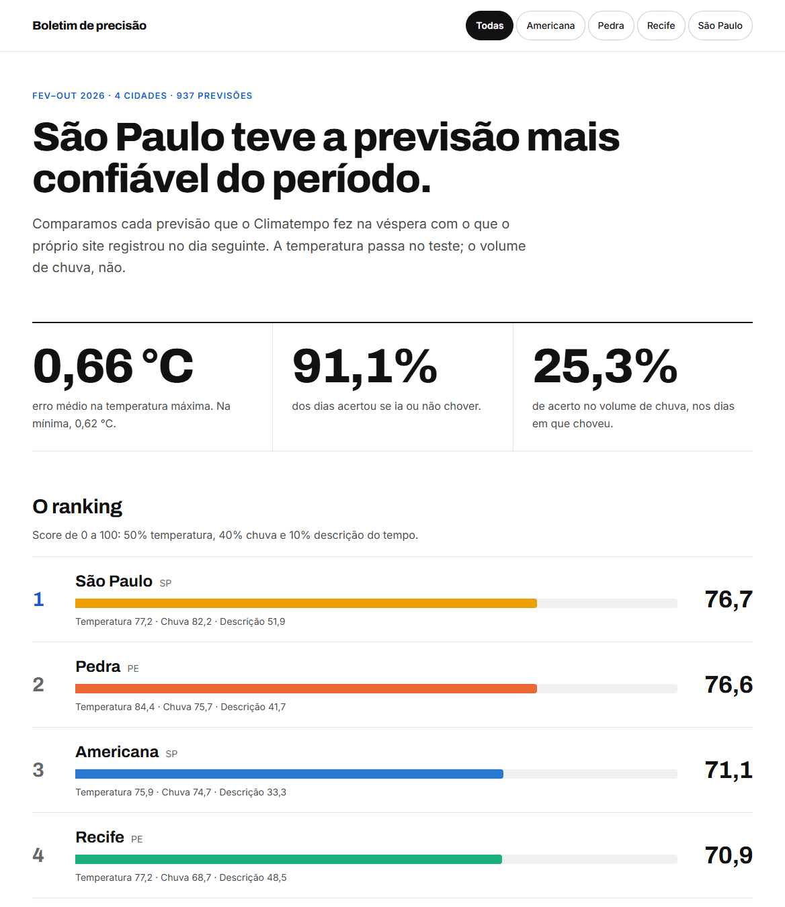
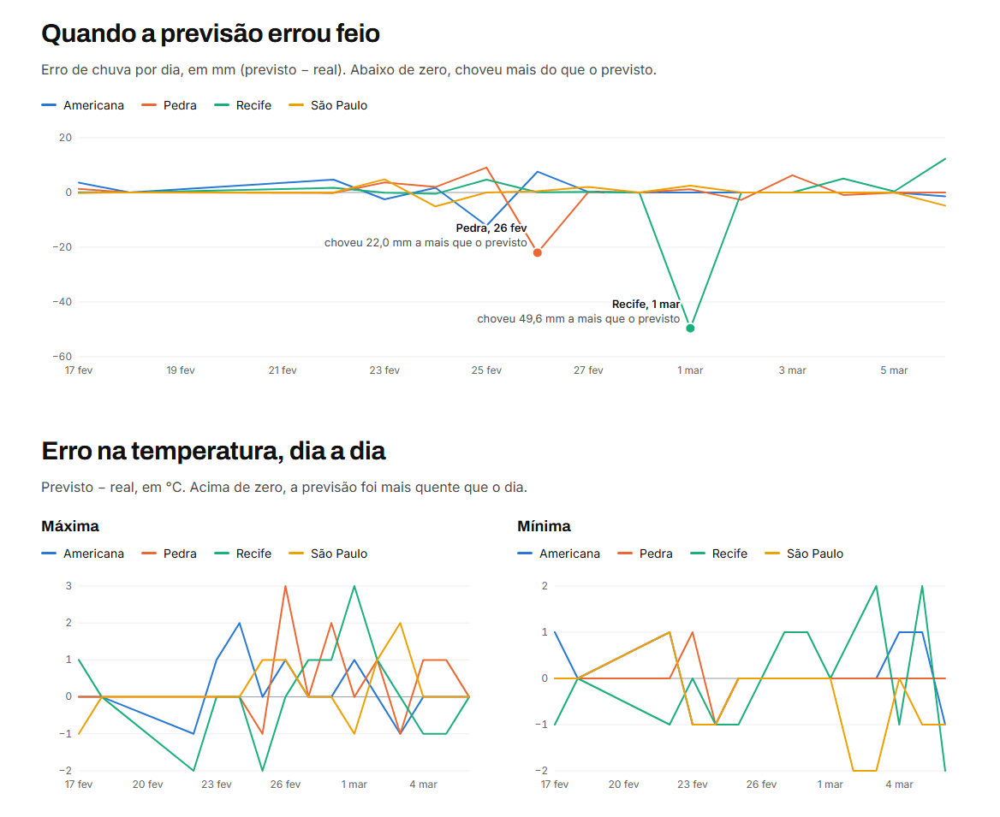
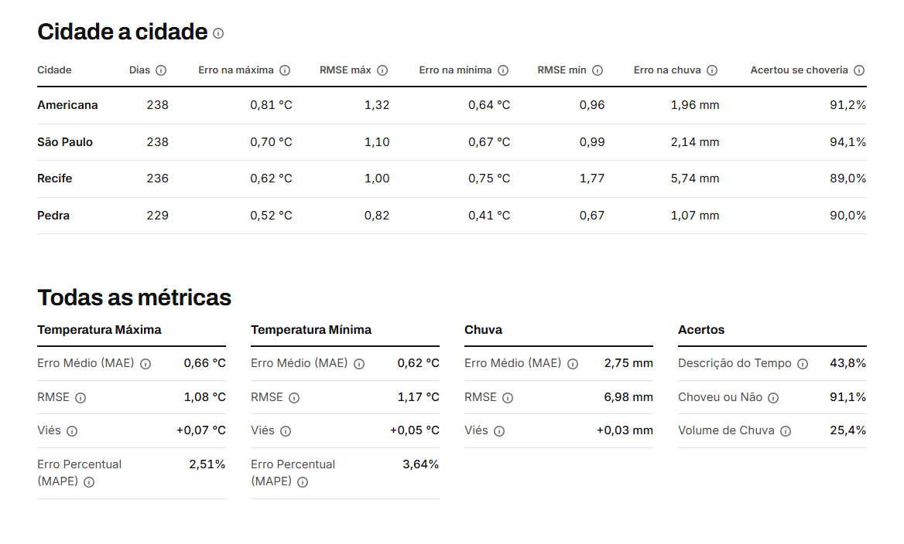

# 🌦️ Webscraping Climatempo — Qualidade da Previsão do Tempo

Todo dia, um workflow coleta a previsão do Climatempo para 34 cidades e guarda no repositório. No dia seguinte, a coleta mostra o que de fato foi registrado. Um dashboard compara os dois e mede **o quanto a previsão acerta**. Por enquanto, o dashboard exibe só as 4 cidades originais; as outras 30 entraram na coleta em 21/10/2026 e ainda estão juntando histórico.





---

# 🏗️ Como funciona

```
GitHub Actions (todo dia, 13h)
        │
        ▼
Scrapy coleta ──► data/bronze/previsoes.jsonl ──► commit no main
                  (histórico completo)                  │
                                                        ▼
                                              Dashboard (Next.js)
                                      compara a previsão de D-1 com o dado de D
```

Não há banco de dados: o histórico da coleta é um arquivo de texto versionado, e o dashboard calcula tudo a partir dele. O Git é o banco, e cada dia de coleta é um commit.

```
.github/workflows/   workflow diário de coleta
ingestion/           projeto Scrapy e validação da coleta
data/bronze/         histórico da coleta (JSON Lines)
dashboard/           dashboard em Next.js + React
docs/                imagens
```

Cada pasta tem um README com o que ela faz e como rodar.

---

# ⚙️ Coleta diária

O workflow [`coleta.yml`](.github/workflows/coleta.yml):

1. roda o spider e **acrescenta** as leituras do dia em `data/bronze/previsoes.jsonl`;
2. faz commit e push no `main`;
3. **valida** a coleta (uma leitura de hoje e uma de previsão para cada cidade, com temperatura e chuva legíveis) e fica vermelho se algo estiver errado.

O commit vem antes da validação de propósito: uma leitura ruim não faz o dia inteiro se perder, e o job ainda avisa.

O spider coleta, de cada cidade, o dado de hoje e a previsão para amanhã: temperatura mínima e máxima, descrição e volume de chuva.

---

# 📊 Como a previsão é medida

Compara a previsão coletada em D-1 com o dado observado em D.

Métricas calculadas:

* Erro médio, RMSE, viés e erro percentual da temperatura máxima e mínima, e erro médio, RMSE e viés da chuva
* Acerto de "choveu ou não", do volume de chuva e da descrição do tempo
* Score composto por cidade, que gera o ranking

Ranking final ponderado:

* 50% Temperatura
* 40% Chuva
* 10% Descrição

Leituras ilegíveis do site (o `-` no lugar da temperatura, chuva vazia) viram **valores ausentes**, e não zero, para não distorcer as médias.

---

# 🧠 Stack

* Python + Scrapy
* GitHub Actions
* Next.js + React + TypeScript
* Vitest

---

# 🚀 Como Executar

Requisitos: Python 3.11+ e Node.js 20.9+.

**Dashboard** ([detalhes](dashboard/README.md)): lê o histórico que já está no repositório.

```bash
cd dashboard
npm install
npm run dev
```

**Coleta** ([detalhes](ingestion/README.md)): o workflow já roda sozinho, mas dá para rodar à mão.

```bash
cd ingestion
pip install -r requirements.txt
scrapy crawl previsao -o ../data/bronze/previsoes.jsonl
```

---

# 📌 O que este projeto demonstra

* Coleta automatizada e agendada, com validação que falha de forma visível
* Dados versionados no próprio repositório
* Métricas de avaliação preditiva e tratamento de dados ausentes
* Dashboard com testes, incluindo paridade com a versão anterior
